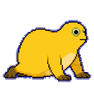
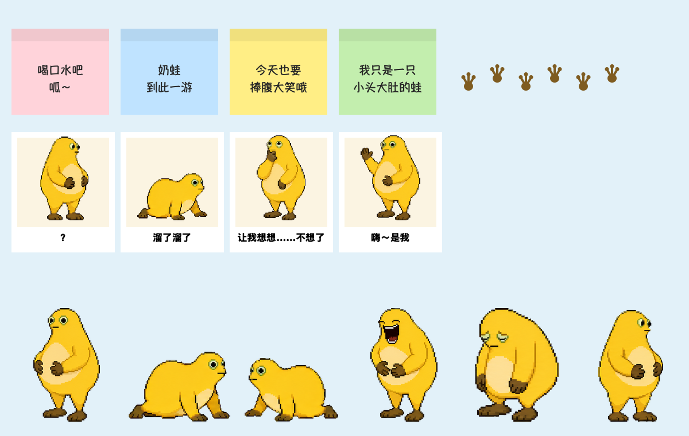

# 桌面奶蛙 Desktop Naiwa 🐸

<p>
  
  
</p>

一只会在你 Mac 桌面上乱爬、叼走你鼠标、往桌上丢便签和表情包的奶蛙。

玩法参考 Sam Chiet 的 [Desktop Goose](https://samperson.itch.io/desktop-goose)，主角换成了小头大肚、一碰就捧腹大笑的奶蛙。



## 它会干什么

- 🐾 在所有窗口最上层爬来爬去、东张西望，盯着你的鼠标看，走过的地方留下慢慢消失的小脚印
- 🖱️ 时不时冲过来**叼住鼠标指针**拖着跑两三秒，嘴里还「呱呱」叫
- 📝 跑到屏幕边缘，**拖出便签**（「ddl 是第一生产力」「蛙生苦短，及时摸鱼」……）丢在桌面上
- 🖼️ 拖出**奶蛙表情包**，也可以拖出你自己放进去的图片
- 😆 鼠标停在它身上它会捧腹大笑，还能用鼠标把它拎起来扔到别处

背景完全透明，点击会穿透到下面的窗口，只有奶蛙和便签本身能点，不影响正常用电脑。

## 放心玩：只是恶搞，不搞破坏

- 不读、不改、不删任何文件，不联网
- 不会替你点鼠标或按键盘，只会挪一下指针的位置
- 你按着鼠标键的时候（比如正在拖文件），它不会来抢鼠标，已经叼着的也会马上松口
- 一个菜单就能暂停或退出

## 下载安装

> 需要 macOS 13 或更新版本，Apple 芯片和 Intel 芯片的 Mac 都能用。

1. 到 [Releases](../../releases/latest) 下载 `桌面奶蛙.zip`，双击解压
2. 把「桌面奶蛙.app」拖进「应用程序」文件夹
3. 第一次打开：因为没有付费的苹果开发者签名，macOS 会提示「无法验证开发者」。处理方法：
   - 先双击打开一次，看到提示后点「完成」
   - 打开「系统设置 → 隐私与安全性」，拉到最下面，点「仍要打开」，然后输入开机密码
   - 之后就能正常双击打开了

   也可以在「终端」里运行这一行，效果一样：

   ```bash
   xattr -dr com.apple.quarantine /Applications/桌面奶蛙.app
   ```

## 怎么退出

三选一：

1. **按住 Esc 键 3 秒**，奶蛙头顶会倒数，数完它就走了
2. 点屏幕右上角**菜单栏里的蛙头图标** →「退出桌面奶蛙」
3. 在奶蛙身上**点右键** →「退出桌面奶蛙」

## 菜单栏里能调什么

| 菜单项 | 作用 |
| --- | --- |
| 暂停捣蛋 | 奶蛙坐下来托腮思考，啥也不干。适合上课投屏、开会 |
| 马上捣蛋一次 | 不想等就点这个 |
| 恶搞频率 | 佛系（约 2 分钟一次）/ 正常（约 1 分钟，默认）/ 捣蛋（约 15 秒）/ 疯狂（约 5 秒） |
| 恶搞项目 | 单独开关：抢鼠标、拖便签、拖表情包、留脚印、叫声 |
| 奶蛙大小 | 小 / 中 / 大 / 特大 |
| 把奶蛙叫到鼠标旁边 | 找不到它的时候用 |
| 清理桌面上的便签和表情包 | 一键收走 |
| 打开自定义表情包文件夹 | 放进去的 png / jpg / gif / webp，奶蛙会拖出来 |

便签可以拖动；点右上角的 × 或者双击就能关掉。更详细的说明见 [使用说明.md](使用说明.md)。

## 自己编译

需要装好 Xcode（或者 Xcode Command Line Tools）。

```bash
git clone https://github.com/OrientalDaitou/desktop-naiwa.git
cd desktop-naiwa
./build.sh            # 打包到 build/桌面奶蛙.app
./build.sh install    # 打包并安装到 ~/Applications
```

整个程序只有一个文件 [`Sources/main.swift`](Sources/main.swift)，用的是 Swift + AppKit，没有任何第三方依赖：

- 便签文字和表情包配文：`Content` 里，想加什么梗直接加
- 恶搞频率：`Frequency`
- 叫声：`Croak`，代码实时合成，没有用任何音频文件

## 致谢与授权

- 奶蛙像素形象和动画：[sandytruant/codex-pet-naiwa](https://github.com/sandytruant/codex-pet-naiwa)，MIT License，授权全文见 [`Resources/奶蛙素材授权-MIT.txt`](Resources/奶蛙素材授权-MIT.txt)
- 玩法灵感：Sam Chiet 的 [Desktop Goose](https://samperson.itch.io/desktop-goose)。本项目是独立重写的，没有使用 Desktop Goose 的任何代码或素材
- 这是粉丝向的非官方作品，和「奶蛙」形象的原作者、以及任何官方「奶蛙」应用都没有关系
- 本项目代码：[MIT License](LICENSE)

---

## English

**Desktop Naiwa** is a Desktop Goose–style prank pet for macOS, starring Naiwa, a chubby yellow pixel frog. It crawls around on top of every window, leaves footprints, steals your mouse cursor for a few seconds, and drags sticky notes and memes in from the screen edges. Clicks pass through everywhere except the frog and its notes. It never touches your files and never clicks or types for you.

- **Quit:** hold <kbd>Esc</kbd> for 3 seconds, or use the frog icon in the menu bar (also available by right-clicking the frog).
- **Prank frequency:** menu bar icon → 恶搞频率 (about every 2 min / 1 min / 15 s / 5 s).
- **Build:** `./build.sh install` (requires Xcode). Single-file Swift/AppKit app, no dependencies.
- **Credits:** frog sprites by [sandytruant/codex-pet-naiwa](https://github.com/sandytruant/codex-pet-naiwa) (MIT). Inspired by Sam Chiet's Desktop Goose. Unofficial fan project. Code is MIT licensed.
